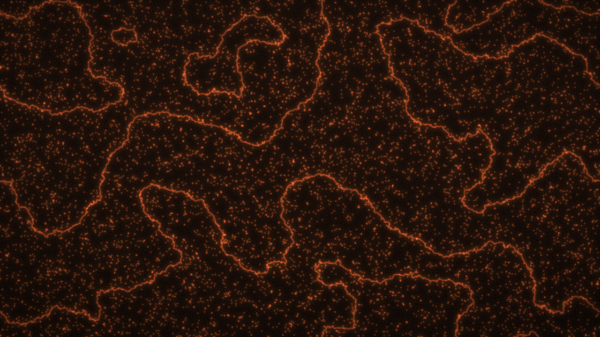
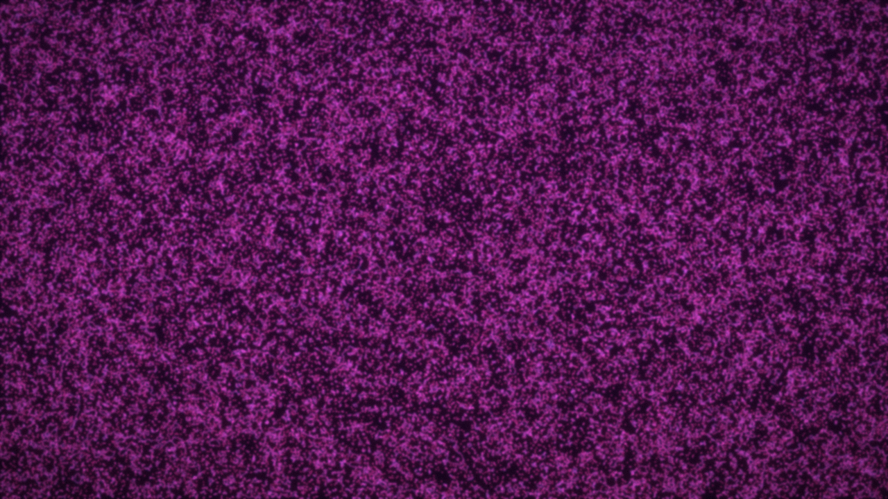
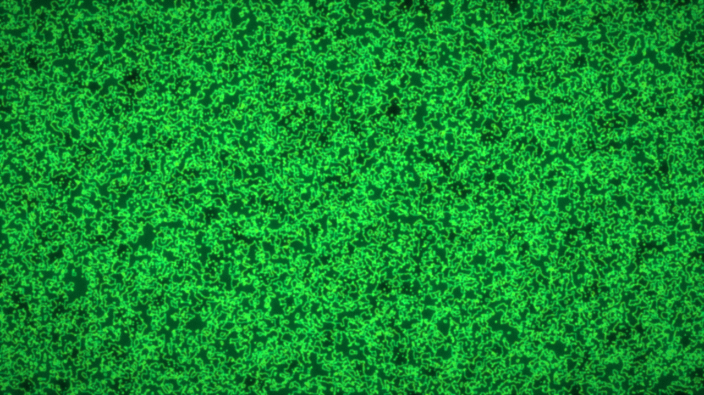
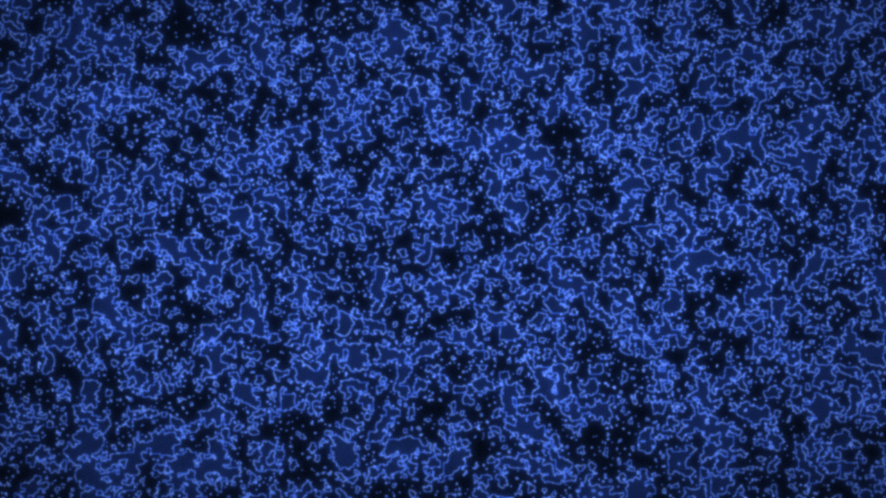
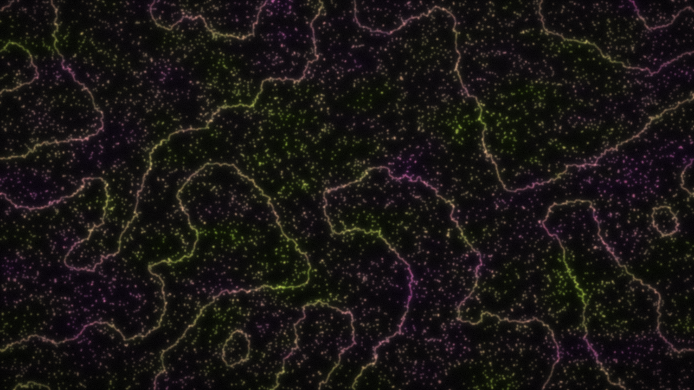
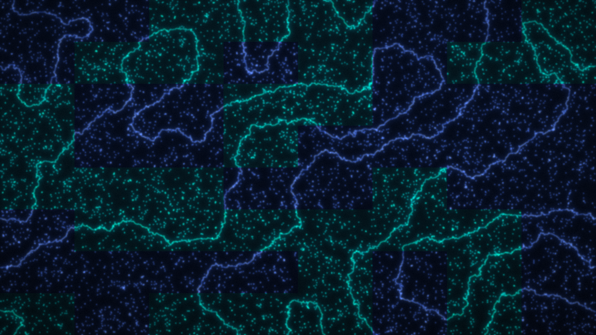

# RFIM Wallpaper

```
 ____  _____ ___ __  __
|  _ \|  ___|_ _|  \/  |
| |_) | |_   | || |\/| |
|  _ <|  _|  | || |  | |
|_| \_\_|   |___|_|  |_|

__        ___    _     _     ____   _    ____  _____ ____
\ \      / / \  | |   | |   |  _ \ / \  |  _ \| ____|  _ \
 \ \ /\ / / _ \ | |   | |   | |_) / _ \ | |_) |  _| | |_) |
  \ V  V / ___ \| |___| |___|  __/ ___ \|  __/| |___|  _ <
   \_/\_/_/   \_\_____|_____|_| /_/   \_\_|   |_____|_| \_\
```

**Statistical mechanics as desktop art.** A GPU-accelerated
[Random Field Ising Model](https://en.wikipedia.org/wiki/Random_field_Ising_model)
that turns quenched disorder, Barkhausen avalanches and critical phenomena into
fractal wallpapers — one spin per pixel, at native resolution.

```
H = -J Σ s_i s_j  -  Σ h_i s_i  -  H_ext Σ s_i ,     h_i ~ N(0, Δ)
```

## Gallery

| Embers — thermal | Critical Ising (T_c) |
|---|---|
|  |  |

| Avalanches (T = 0) | Asymmetric islands |
|---|---|
|  |  |

| Two-color blend (`clouds`) | Hard zones (`zones`) |
|---|---|
|  |  |

## Two dynamics, one Hamiltonian

| mode | physics | knobs |
|------|---------|-------|
| `avalanche` | **T = 0** field ramp → Barkhausen crackling. Spins start all-down and `H_ext` is ramped; each step relaxes to the unique ground state (Middleton *no-passing* theorem). The bursts of flips are the avalanches. | `--disorder`, `--ramp-steps`, `--target-m` |
| `thermal` | **finite T** Metropolis Monte Carlo, vectorized on the checkerboard. `Δ = 0`, `T = T_c ≈ 2.269` reproduces the clean 2D Ising critical point; `Δ > 0` pins and roughens the walls (Imry–Ma disorder in `d = 2`). | `--temperature`, `--disorder`, `--field`, `--sweeps` |

## Features

- **One spin = one pixel** — no upscaling blur, up to 4K.
- **Two dynamics** — finite-temperature Monte Carlo and T = 0 avalanche ramps.
- **14 color themes** with **spatial mixing** (`--colors a,b`).
- **Named presets** spanning the phase diagram.
- **Reproducible** — same seed, same image, even on GPU.
- **Pure PyTorch/CUDA** pipeline: field generation, neighbor sums, relaxation, walls and blur all run as GPU tensors.

## Install

```bash
conda create -n wallpaper python=3.12 -y
conda activate wallpaper
pip install torch --index-url https://download.pytorch.org/whl/cu126   # match your driver
pip install -e .
```

Verify the GPU:

```bash
python -c "import torch; print(torch.cuda.is_available())"   # True
```

## Quickstart

```bash
rfim-wallpaper                                  # default: embers, sparse thermal
rfim-wallpaper --preset pulito --resolution qhd # clean Ising at T_c, 2K
rfim-wallpaper --preset caos                    # fragmented chaos
rfim-wallpaper --colors matrix                  # solid theme
rfim-wallpaper --colors plasma,lime --mix clouds
```

Output: `~/rfim-wallpaper.png` (override with `--out`).

## Color themes

14 themes ship in [`colors.toml`](rfim_wallpaper/colors.toml) — edit it to add
your own.

```
braci · plasma · matrix · neon · synthwave · abyss · blue
lava · aurora · acid · lime · cobalt · solar · graphite
```

```bash
rfim-wallpaper --list-colors          # print them with swatches
rfim-wallpaper --colors neon          # a single theme
rfim-wallpaper --colors blue,lime     # blend zones of two themes
```

`--mix` controls how multiple colors combine:

| mode | look |
|------|------|
| `clouds` *(default)* | smooth organic zones |
| `gradient` | diagonal blend |
| `radial` | center vs. edges |
| `angular` | around the center |
| `zones` | hard Voronoi-like cells |

## Presets

Six recipes in [`presets.toml`](rfim_wallpaper/presets.toml), each a distinct
regime:

| preset | mode | character |
|--------|------|-----------|
| `pulito`  | thermal   | clean Ising at T_c — critical fractal |
| `fumo`    | thermal   | below T_c — large ordered domains (sparse) |
| `torbido` | thermal   | above T_c — fine paramagnetic grain (dense) |
| `braci`   | avalanche | coercive field — balanced crackling |
| `isole`   | avalanche | asymmetric — minority "islands" |
| `caos`    | avalanche | strong disorder — fragmented chaos |

```bash
rfim-wallpaper --list-presets
rfim-wallpaper --preset fumo --disorder 0.5 --sweeps 1000   # override anything
```

## CLI

```
--resolution {hd,fhd,qhd,uhd,native}   output size (1 spin = 1 px)
--width / --height                     free-form size
--style {texture,material}             rendering style
--mode {thermal,avalanche}             dynamics
--preset NAME                          parameter recipe
--colors A[,B,...]                     color theme(s)
--mix {clouds,gradient,radial,angular,zones}
--disorder Δ · --temperature T · --field H
--sweeps N · --ramp-steps N · --target-m M
--seed N · --cpu · --out PATH
--list-colors · --list-presets
```

## Reproducibility

The quenched field and grain are generated deterministically on the CPU, and the
GPU only runs deterministic math, so the same seed gives the same image — even
across GPU runs.

## License

[MIT](LICENSE)
